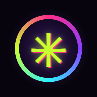
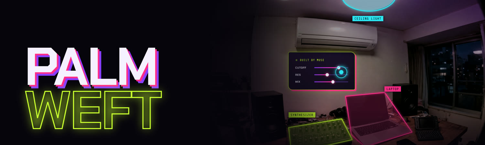
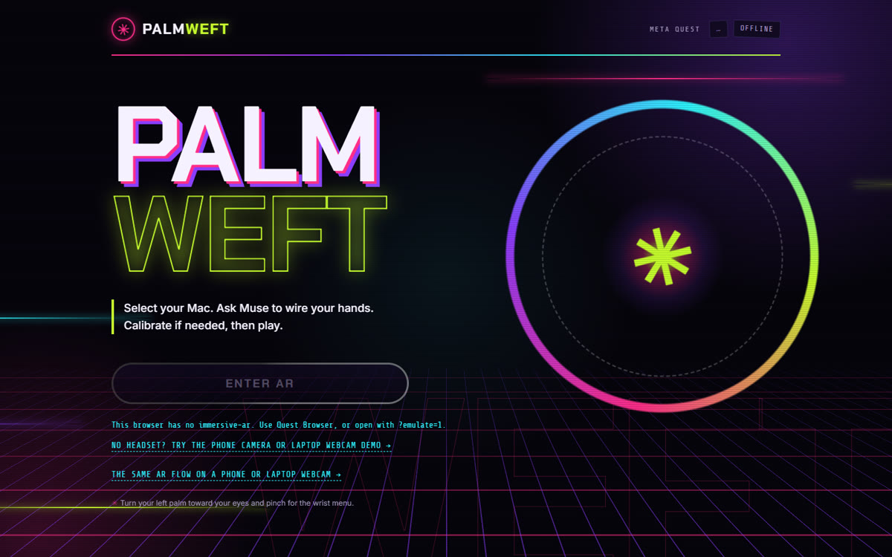
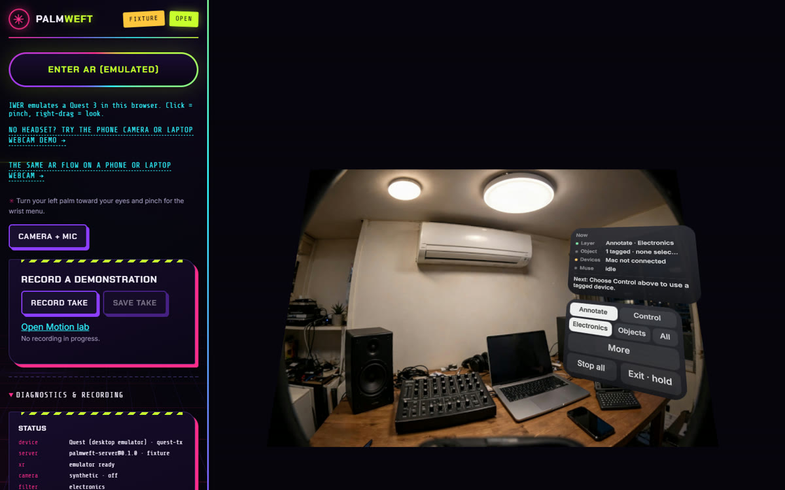
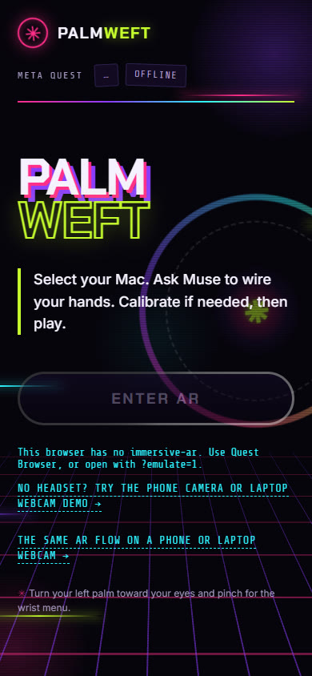

<p align="center">
  
</p>

<h1 align="center">Palmweft</h1>

<p align="center">
  <b>Look at a device. Ask for what you want. Play it with your hands.</b><br />
  Meta Quest 3 · WebXR · SAM 3.1 · Muse
</p>

<p align="center">
  
</p>

Point at a device in Meta Quest passthrough, ask what you want to do, and use the spatial controls an agent builds for it.

Palmweft combines a WebXR interface, a Node server, and a Chrome companion. SAM identifies objects; Muse writes, deploys, and tests connector code on the server. The wearer then uses generated controls or hand interactions. Selecting an object and approving a connection do not themselves authorize device actions.

## How it works

1. **Look.** Frames from the Quest passthrough camera go to SAM 3.1, which outlines electronic devices, lights and synthesizers (never people). Muse Spark identifies the selected device and tags it in place.
2. **Ask.** Switch to Control and speak (push-to-talk, transcribed by Muse Voice Transcribe) or type. A Muse coding agent on the server writes a Node connector for that device, deploys it, and tests it.
3. **Play.** The agent returns a validated 3D instrument and/or a sandboxed hand program that maps hand signals (height, pinch, fist, palm, screen touches) to the device's actions.

Nothing is pre-wired: hands do nothing to a device until a program the wearer asked for is running. Both palms facing outward stops everything.

## Screenshots

| Headset launcher | Desktop emulator (FIXTURE mode) |
| --- | --- |
|  |  |

<p align="center"></p>

## Run locally

Requirements: Node.js 22.12 or newer and npm. The headset experience needs a compatible Quest browser, a reachable server, and trusted HTTPS. Physical MIDI and serial devices use the Chrome companion on the computer running the server.

```sh
git clone https://github.com/MitudruDutta/palmweft.git
cd palmweft
npm ci
cp .env.example .env
npm run build
npm start
```

The repository is private; cloning requires access. Use the server's printed URL to open the companion on the computer and `/quest/` on the headset. Build only when an active headset session is not using the build output. For development, `npm run dev` runs the server, companion and Quest builds in watch mode.

Without `MODEL_API_KEY`, the app uses visibly labelled **FIXTURE** recordings or scripted responses. These demonstrate integration, not a new live model decision. Configure the key in the private `.env` for live model calls. Keys stay on the server.

For a browser-only demonstration:

```sh
npm run demo:sim -- --fixture
```

On a desktop browser without WebXR, `/quest/` opens the emulator (IWER): click to pinch, right-drag to look. The simulator and camera/touch pages support review without hardware. They do not establish headset hand tracking, real passthrough, physical device effects, or headset performance.

## Hand interactions

- **Point and pinch:** aim with the index fingertip and pinch to select. Pinch closes under 2 cm and releases past 3.5 cm, so brief tracking loss never creates a phantom click.
- **Wrist menu:** raise a flat, still hand with the palm toward your eyes (or add a 250 ms pinch); touch thumb to middle, ring or pinky to choose.
- **Screen calibration:** touch a screen's top-left, then bottom-right corner to turn it into a touch surface.
- **Stop:** both palms facing outward for 120 ms.

Details: [apps/quest/HANDS.md](apps/quest/HANDS.md) and [apps/quest/src/gestures/README.md](apps/quest/src/gestures/README.md).

## Repository

| Path | Purpose |
| --- | --- |
| `apps/server` | Pairing, model adapters, agent execution, connector lifecycle, and device routing |
| `apps/quest` | Passthrough, hand input, generated spatial controls, and recordings |
| `apps/companion` | Desktop pairing, MIDI/serial execution, instruments, and diagnostics |
| `apps/sim` | Explicit simulated room and devices |
| `apps/iphone/Palmweft` | Optional native iPhone client |
| `apps/devterm` | Optional terminal client |
| `firmware/cardputer` | IR node firmware |
| `packages` | Shared protocol, spatial control specifications, and instrument engines |

More detail: [server](apps/server/README.md) · [companion](apps/companion/README.md) · [simulator](apps/sim/README.md) · [terminal client](apps/devterm/README.md) · [Cardputer firmware](firmware/cardputer/README.md)

## Checks

```sh
npm run typecheck
npm test
npm run test:quest-live
python3 -m unittest discover -s apps/devterm/tests
node scripts/bundle-third-party-notices.mjs --check
node scripts/audit-public.mjs --history
```

Browser and device checks have additional prerequisites; existing historical results are not verification of a new build.

## Security

Generated Node connectors run with the server user's OS permissions. Use a trusted local setup; do not expose the coding agent as a shared public service. The server treats loopback connections as the owner, so do not put it behind a same-machine tunnel or reverse proxy without setting `CE_TRUST_LOOPBACK=0`. Stop retires the active connector and its outputs.

## License

The source is distributed under the [MIT license](LICENSE). Existing copyright notices and dependency licenses remain in force. Bundled dependency notices are available under each web app's `public/notices/` directory.
